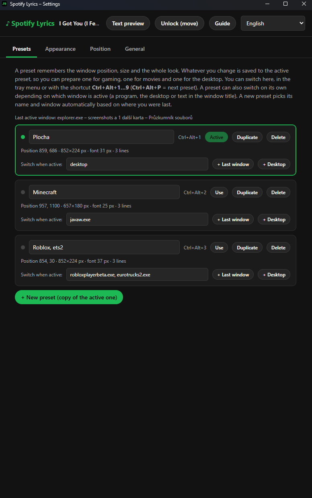
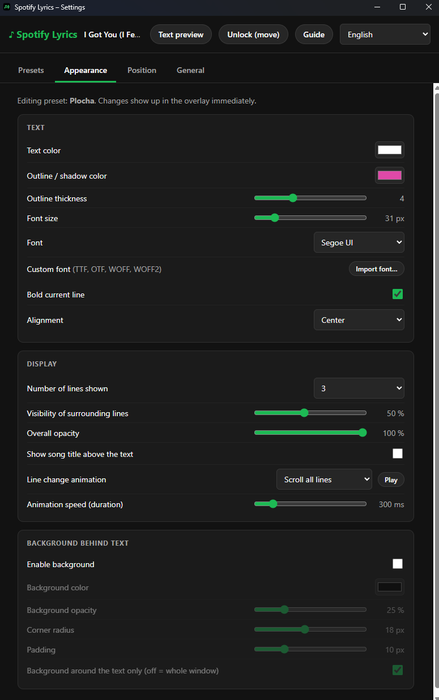
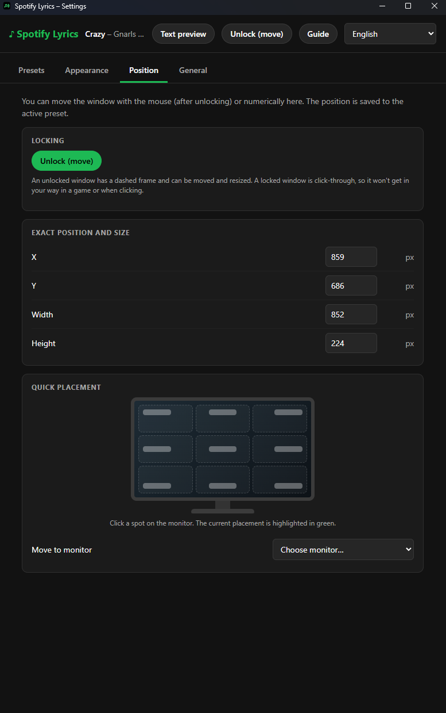
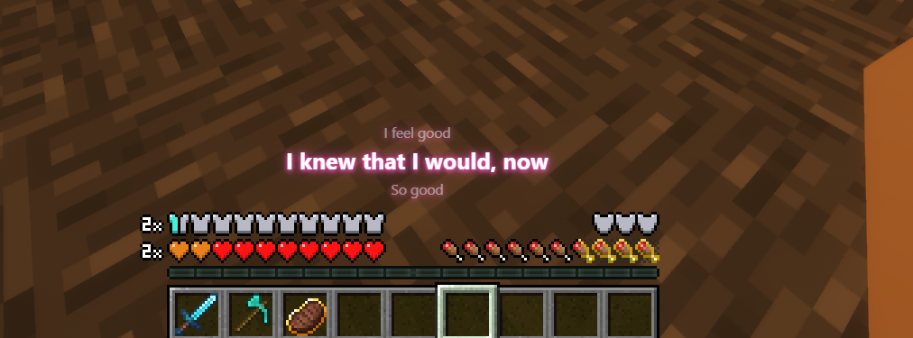

<div align="center">

# Spotify Lyrics Overlay

Live, synced lyrics of the song you're playing on Spotify, floating on top of your games, videos and desktop.

[](https://github.com/Dragouncz/spotify-lyrics-overlay/releases/latest)

### Ukázka nastavení
<p align="center">
  
  
  
</p>

### Ukázka ve hře
<p align="center">
  
  
</p>

</div>

---

## What is it?

It's a transparent window that stays on top of everything and shows the lyrics of the song you're playing in Spotify, line by line, in sync. You can click straight through it, so it doesn't get in the way when you play, watch something or work.

## Features

- **Click-through overlay.** Always on top. Unlock it to move and resize, lock it to ignore clicks.
- **Presets.** Save the position, size and look. Make one for games, one for movies, one for the desktop.
- **Auto-switching.** Presets change on their own depending on the active window (a game, a browser tab, the desktop).
- **Customizable look.** Colors, outline, font, size, alignment, 1 / 3 / 5 lines, opacity and a background box.
- **Your own fonts.** Import any TTF, OTF, WOFF or WOFF2 font.
- **14 animations.** Fade, slides, zoom, pop, blur, bounce, flip, flash, typewriter, scroll and more.
- **Sync adjustment.** If the lyrics come too early or too late, nudge them with a hotkey.
- **10 languages.** English, Čeština, Slovenčina, Deutsch, Русский, 中文, Español, Français, Bahasa Indonesia, 日本語.
- **First-run guide.** Takes you through the setup step by step.

## Install

1. Go to the [Releases page](https://github.com/Dragouncz/spotify-lyrics-overlay/releases/latest) and download `Spotify-Lyrics-Overlay-Setup-x.x.x.exe`.
2. Run it. The app installs, starts on its own and adds a desktop shortcut.
3. Follow the guide that opens (details below).

> **Windows shows a blue "protected your PC" warning?**
> The installer isn't code-signed, since certificates cost money. Click **More info**, then **Run anyway**.
> Here's the [VirusTotal report](https://www.virustotal.com/gui/file/7050efd5c69dad3b31466ecac844663adb6c9ded75322dfbcd9acc1d7a7aba83/detection) if you want to check.

## First-time setup

Takes about 2 minutes and you only do it once. Spotify requires every app to have its own free Client ID. The in-app guide walks you through it, and these are the same steps:

1. Open the [Spotify Developer Dashboard](https://developer.spotify.com/dashboard), log in and click **Create app**.
2. The name and description can be anything.
3. In **Redirect URI**, paste this exactly and click **Add**:
   ```
   http://127.0.0.1:8888/callback
   ```
4. Under **Which API/SDKs are you planning to use?**, tick **Web API**.
5. Accept the terms and click **Save**.
6. Open your new app's **Settings**, copy the **Client ID** and paste it into the app. It logs you in automatically.

Play a song in Spotify and the lyrics will show up.

## How to use

Click the tray icon to open the settings. Right-click it for the quick menu (presets, lock, show/hide, quit).

To move the window, unlock it first (you'll see a dashed frame). Then drag it with the mouse and resize it by dragging the edges. You can also use the **Position** tab for exact numbers and a 9-spot quick placement. When you're done, lock it again with `Ctrl+Alt+L`.

### Hotkeys

| Shortcut | Action |
|---|---|
| `Ctrl+Alt+L` | Lock / unlock (click-through) |
| `Ctrl+Alt+H` | Hide / show lyrics |
| `Ctrl+Alt+S` | Open settings |
| `Ctrl+Alt+1` … `9` | Switch to preset 1–9 |
| `Ctrl+Alt+P` | Next preset |
| `Ctrl+Alt+↑` / `↓` | Bigger / smaller font |
| `Ctrl+Alt+←` / `→` | Lyrics later / earlier by 250 ms |
| `Ctrl+Alt+Q` | Quit |

### Presets and auto-switching

A preset remembers the window position, the size and the whole look. Anything you change is saved into the active preset.

In **Switch when active** you can enter these, separated by commas:

| Value | Meaning |
|---|---|
| `chrome.exe` | a program (`.exe` is optional) |
| `desktop` | the Windows desktop |
| `title:YouTube` | text in the window title (browser tabs, Store apps) |

If you don't want to type, click **+ Last window** or **+ Desktop** and it fills it in for you. When you switch to a window that has no preset, your previous preset comes back.

You can also turn on **Hide text in windows that have no preset** (General tab, on by default). Then the lyrics only show up where you want them.

### Custom fonts

Go to the Appearance tab and click **Import font…**. Your fonts show up under **My fonts**.

## FAQ and troubleshooting

<details>
<summary>Do I need Spotify Premium?</summary>

No, it works with both Free and Premium.
</details>

<details>
<summary>I get error 403</summary>

Open your app in the Spotify Developer Dashboard, go to **User Management** and add your own Spotify account (name and email). Then log out and back in under Settings → General.
</details>

<details>
<summary>Login does nothing / "Port 8888 cannot be opened"</summary>

Another program is using port 8888. Close it and click **Log in again**.
</details>

<details>
<summary>"No synced lyrics for this song"</summary>

The lyrics come from [LRCLIB](https://lrclib.net), a free community database, and it doesn't have every song yet. Anyone can add missing lyrics there.
</details>

<details>
<summary>The lyrics are a little early or late</summary>

Press `Ctrl+Alt+←` / `→` (250 ms per press), or set the offset in Settings → General.
</details>

<details>
<summary>It doesn't show in my game</summary>

Games in exclusive fullscreen can't show overlays. Switch the game to windowed or borderless mode.
</details>

<details>
<summary>How do I uninstall it?</summary>

Go to Settings → General → **Uninstall**. You can also delete your settings and Spotify login from there. The normal Windows "Apps" list works too.
</details>

## Privacy

- The app only talks to Spotify (to see which song is playing) and LRCLIB (to get the lyrics).
- There are no accounts and no tracking, and no data is sent to me or anyone else.
- Your settings and login token stay on your PC in `%APPDATA%\spotify-lyrics-overlay\`.
- It uses the official Spotify login (PKCE), so the app never sees your Spotify password.

## Feedback

Found a bug or have an idea? Open an [issue](https://github.com/Dragouncz/spotify-lyrics-overlay/issues). If you're reporting a bug, include the last lines of `%APPDATA%\spotify-lyrics-overlay\log.txt` (remove anything private first).

---

<div align="center">

Free to use. Not affiliated with, endorsed by or sponsored by Spotify.
Lyrics provided by [LRCLIB](https://lrclib.net).

</div>
